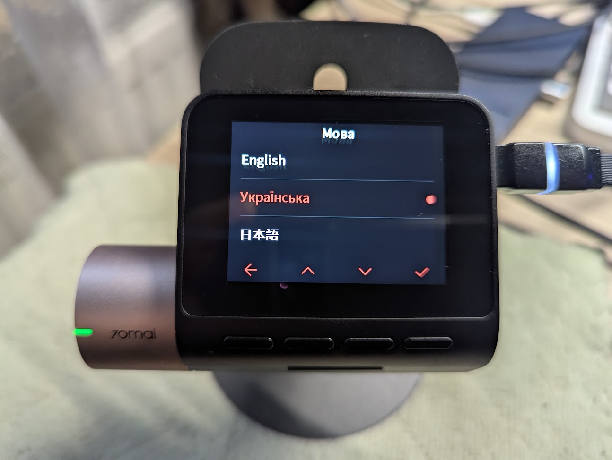
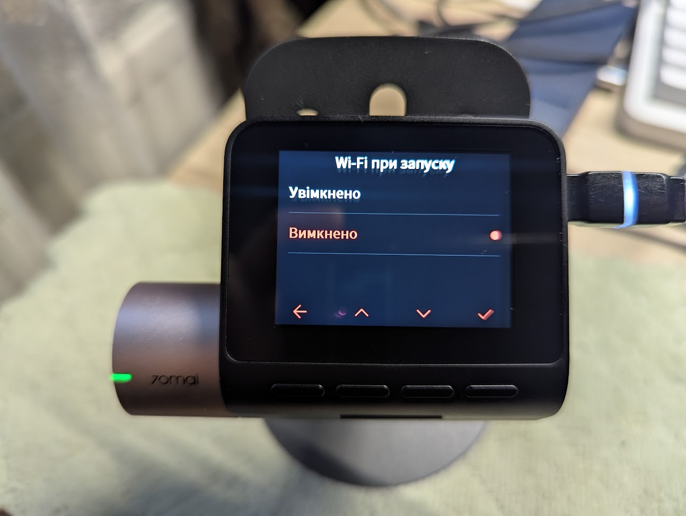
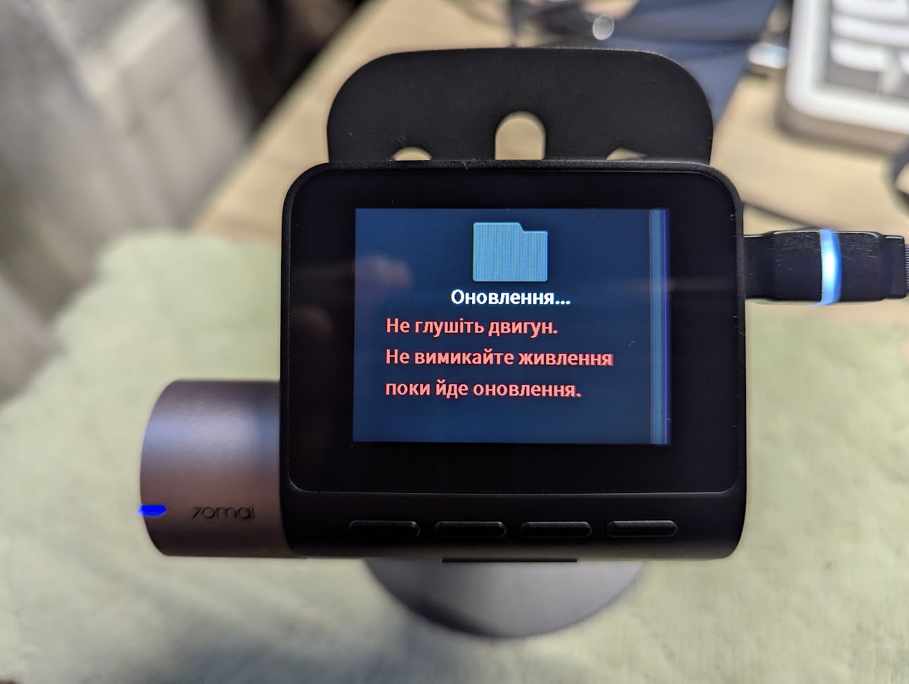
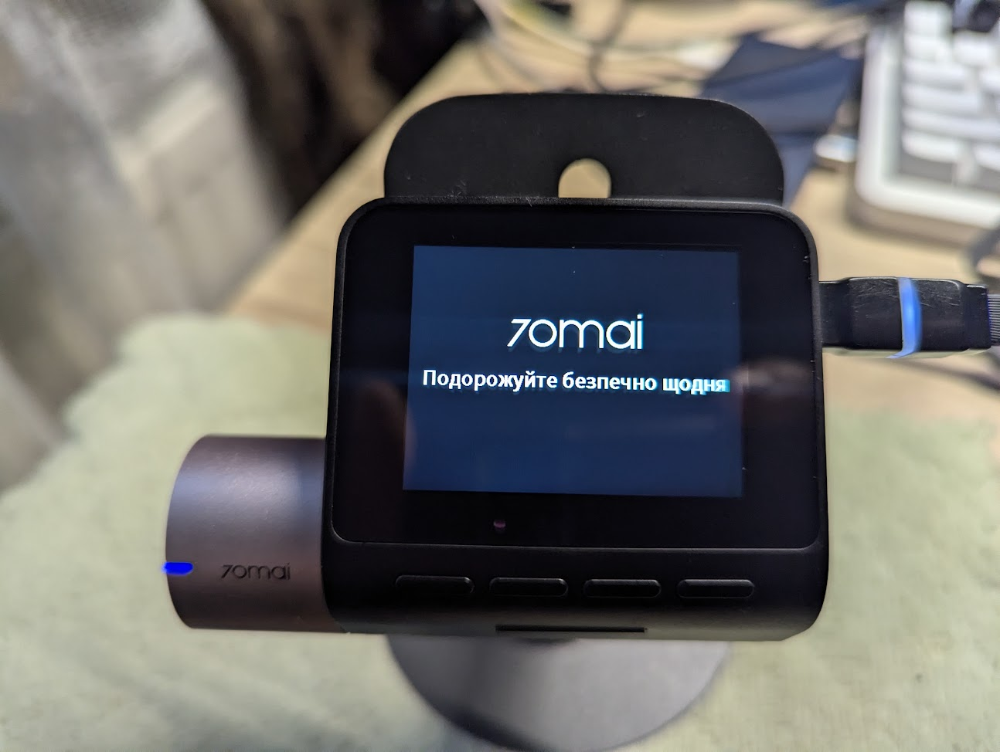

# Українське меню й озвучка для 70mai Dash Cam Lite

Патч до **Midrive D08, 1.0.5.ww, ID 29001003**. Потрібні Python 3 та оригінальний розпакований `FW_DR0010.bin` саме цієї версії. Вихідний образ має SHA-256 `51138cff14af43916ea9d1e828d8c4a5e4534e7b5f3d21af15857cd533efc344`.

## Що змінено

- Українське меню з пунктом «Українська» та повними назвами «Увімкнено» і «Вимкнено».
- 19 українських фраз Олесі (Respeecher), магічні сигнали, кнопка зі щипком струни, плавне затухання запуску й вимкнення.
- На D08 підтверджено напис «Українська» з літерою ї, стани Wi-Fi та прощання «Подорожуйте безпечно щодня». У частині рядків для відображення використані латинські i та M.

## Фото з D08

| Вибір української мови | Стани Wi-Fi |
| --- | --- |
|  |  |

| Оновлення | Вимкнення |
| --- | --- |
|  |  |

## Збірка та встановлення

1. Збережіть оригінальний `FW_DR0010.bin` для відкату.
2. Підготуйте окрему папку для вихідного файлу та виконайте:

   ```sh
   mkdir -p patched
   python3 apply_patch.py /шлях/до/оригінального/FW_DR0010.bin patched/FW_DR0010.bin
   ```

3. Скопіюйте отриманий файл у корінь microSD FAT32. Вставте картку у вимкнений D08, підключіть живлення й дочекайтеся завершення оновлення. Оберіть «Українська» в меню.
4. Після оновлення перевірте відтворення свіжого запису. Якщо потрібен відкат і реєстратор завантажується, повторіть оновлення зі штатним файлом, замінивши файл на картці.

Це неофіційний патч. Інші моделі 70mai мають інші образи прошивок.
